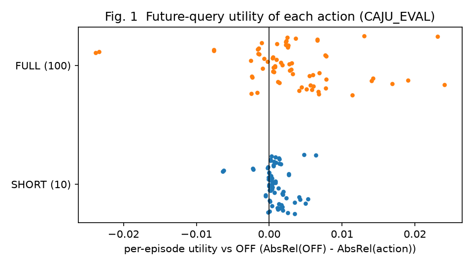
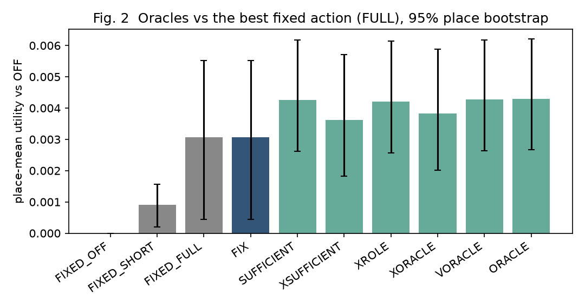
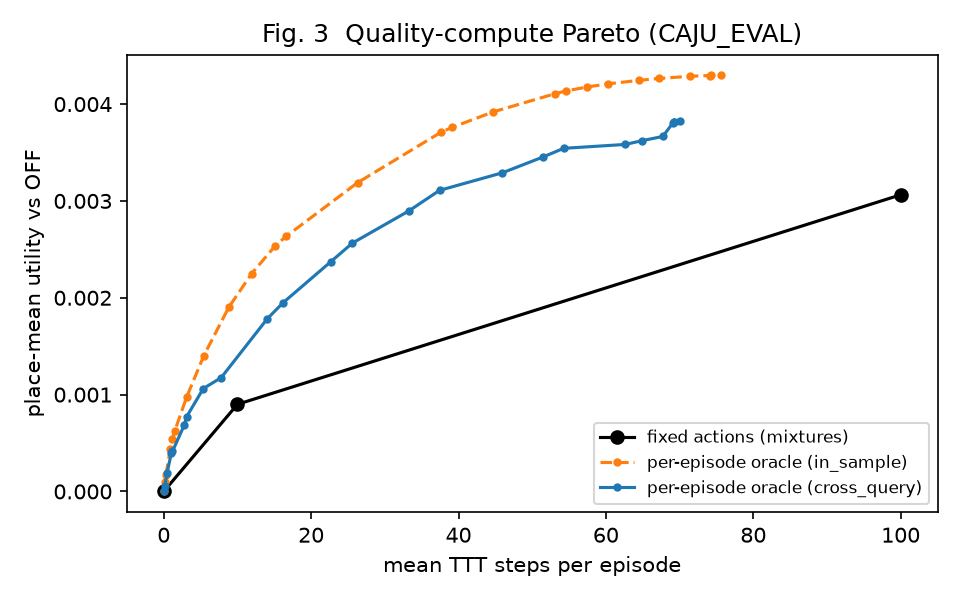
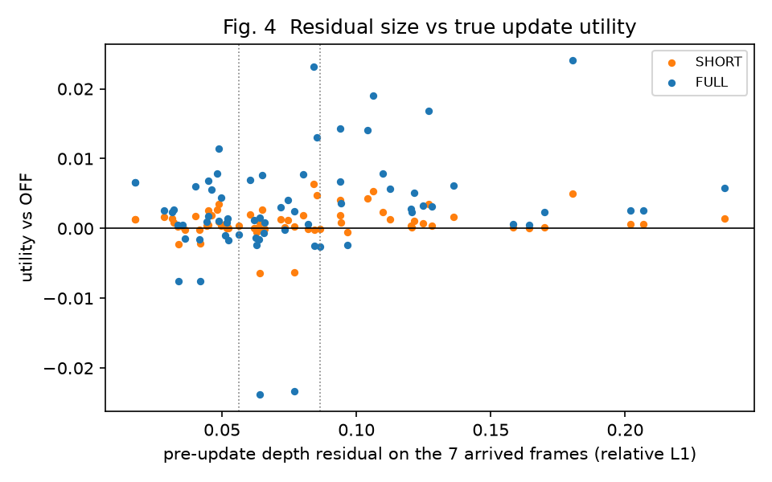
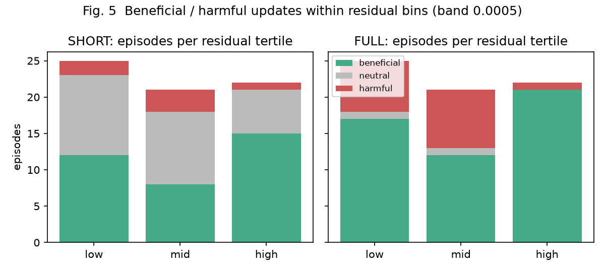

# EXP-3D-CAJU-HEADROOM-V1：Core B 的更新动作有没有值得学习的空间（CAJU-V1 Gate 0）

**结论：`GATE0_STATUS=NOT_ESTABLISHED`，即 `NO_USEFUL_DYNAMIC_ACTION_SPACE`。** 停止 Utility MLP，`GATE1_ALLOWED=false`，不建议进入 AC-JEPA。

1. **主判定没过**：用一个查询帧选动作、在另一个查询帧上评价，按片段选动作的 oracle 比"永远做满 100 步 TTT"只多 +0.00076 AbsRel，95% CI [+0.00005, +0.00191]，低于预注册的实用最小值 0.0010。而且这点收益集中在少数场所：一个场所就贡献了 57%，超过 0.5 的上限。
2. **事后上界也很小**：即使事后为每个片段挑最好的动作，也只多 +0.0012，约为 AbsRel 0.108 的 1.1%。34 个场所里有 24 个场所的两个角色都是 FULL 最好，根本没有可调的空间。
3. **JEPA 无法检验**：项目里不存在真正的 JEPA 预测表征（`JEPA_FEATURE_STATUS=NOT_IMPLEMENTED`），本轮无法检验 JEPA 的作用。

## 问题

Core B 对每个片段固定做 100 步 Gaussian-state TTT。如果有的片段不做或少做 TTT 反而更好，那么"何时更新"就有可能被学习，这正是 CAJU 的前提。Gate 0 不训练任何模型，只回答一个问题：同一片段从同一个状态出发，执行 OFF / SHORT / FULL 三个动作，对未来查询的真实效用差异，是否大到值得去学？

## 设计（详见 [PROTOCOL.md](PROTOCOL.md)，2026-10-14 01:07:17 锁定，sha256 `f82179bf…`）

- **数据**：ARKitScenes Training 折中从未跑过 Core B 的场所。
  - 16 个场所（32 个片段）只用来选最佳固定动作；
  - 34 个场所（68 个片段）用来测 headroom；
  - 8 个 DEV 场所做工程试点；
  - 其余 132 个训练场所保持不动。
- **片段**：沿用 V3 的规则。上下文为 0, 1, 2（A）或 0, 3, 4（B）；流为 5, 8, 10, 13；查询为 14、15，在所有到达帧之后。历史视角是 6, 7, 9, 11, 12，从未被测量。
- **动作**：
  - OFF：7 视角 CACHE；
  - SHORT：同一条 TTT 轨迹的第 10 步；
  - FULL：第 100 步，即 Core B。
  - 三个动作都从同一个 CACHE 状态出发，都用冻结的 Core B 读出 sqrt(R7 × F7)。
- **效用**：U(a) = AbsRel(OFF) − AbsRel(a)，取两个查询的平均。统计单位是场所。
- **主判定**：交叉查询 oracle 减最佳固定动作，要求同时满足四条：均值 ≥ 0.0010、95% 场所 bootstrap 的 CI 下界 > 0、每个留一场所均值都 > 0、正贡献 top-1 场所占比 ≤ 0.5。

## 结果（CAJU_EVAL，34 个场所，68 个片段）

**各动作（Core B 读出，场所平均）**

| 动作 | AbsRel | 相对 OFF 的效用 | 场所 好/平/坏 | 额外计算（中位数，共享 GPU） |
|---|---|---|---|---|
| OFF | 0.1112 | 0 | — | 0 s |
| SHORT（10 步） | 0.1103 | +0.0009 [+0.0002, +0.0016] | 27/0/7 | 8.2 s |
| FULL（100 步） | 0.1082 | +0.0031 [+0.0005, +0.0055] | 26/0/8 | 82.6 s |

- **固定动作的选择**：在 CAJU_SEL 上选出的最佳固定动作是 FULL（SEL 上 SHORT +0.00086，FULL +0.00236）。选择结果的哈希记下之后，才读取 EVAL 的真值。
- **FULL 相对 SHORT 的边际收益**：+0.0022 [+0.0003, +0.0040]，24/0/10。

**策略与 headroom（相对 FULL）**

| 策略 | 场所平均效用 | 平均步数 | 减去 FULL | 95% CI | 场所 好/平/坏 | top-1 占比 |
|---|---|---|---|---|---|---|
| XORACLE（主判定，交叉查询） | 0.00383 | 70.0 | **+0.00076** | [+0.00005, +0.00191] | 9/20/5 | 0.57 |
| ORACLE（逐片段，事后） | 0.00430 | 75.6 | +0.00123 | [+0.00024, +0.00284] | 10/24/0 | 0.56 |
| VORACLE（逐场所，事后） | 0.00427 | 71.8 | +0.00121 | [+0.00021, +0.00282] | 10/24/0 | 0.57 |
| XROLE（交叉角色） | 0.00421 | 75.6 | +0.00115 | [+0.00014, +0.00276] | 7/24/3 | 0.59 |
| XSUFFICIENT（最省充分，交叉查询） | 0.00362 | 66.7 | +0.00056 | [−0.0003, +0.0018] | — | — |

主判定的四条检查：
- 均值 ≥ 0.001：**不通过**（0.00076）；
- CI 下界 > 0：通过；
- 留一场所均值都 > 0：通过（最小 +0.00028）；
- top-1 ≤ 0.5：**不通过**（0.57）。

计算节省分支：XSUFFICIENT 只省了 33% 的步数，要求是 50%，**不通过**。它的质量反而比 FULL 高 0.00056，因为它避开了一部分有害更新。

**动作的异质性**
- 逐片段最优动作的比例：FULL 75%，OFF 19%，SHORT 6%。
- FULL 有害（U < −0.0005）的片段占 24%，有益的占 74%；SHORT 有害的占 9%。
- 同一场所两个角色最优动作相同的比例为 85%，说明最优动作主要是场所层面的性质。
- 排序与众数排序（FULL > SHORT > OFF）不同的片段占 28%。

**残差能说明什么**：更新前残差是 7 个到达帧上第 0 步的深度项。三分位按 100 个正式片段算出，没有用到真值。

| 残差三分位 | FULL 有益/中性/有害 | SHORT 有益/中性/有害 |
|---|---|---|
| 低（< 0.056） | 17/1/7 | 12/11/2 |
| 中（0.056–0.087） | 12/1/8 | 8/10/3 |
| 高（> 0.087） | 21/0/1 | 15/6/1 |

- 残差高时，更新几乎总是有益（22 个片段中 21 个）。
- 残差低或中时，有害更新占 28–38%，有益和有害混在同一残差范围里。这就是任务书 H1 所说的"残差歧义"。但这些有害更新加起来能挽回的收益，就是上面那 +0.0008 到 +0.0012 的上界。
- 与 FULL 效用的 Spearman 相关（片段级，n = 68，只作描述）：
  - 覆盖像素归一化残差的 p90：+0.39；
  - 流视角残差：+0.34；
  - DepthSplat 自身深度相对测量深度的误差：−0.34；
  - 最大相机基线：+0.32；
  - 原始残差均值：+0.25。

**损害**
- **已观测的可靠区域**：FULL 平均只破坏 1.3% 的像素（最多 7.7%），这些区域的误差反而平均下降 0.006。有害的未来查询，在已观测帧上看不出来。
- **历史视角**（流之间从未测量的帧）：FULL 平均改善 0.0037，17.6% 的片段受损。历史视角效用与查询效用的相关只有 0.28，说明"对过去的视角有利"不等于"对未来的视角有利"。

**质量—计算 Pareto**（图 3，只作描述）：按 λ 扫描逐片段 oracle 的前沿，交叉查询版本在平均约 37–46 步时就达到 FULL 的质量（+0.0031 到 +0.0033）。不过 λ 是事后从 52 个取值里挑的，这又是 oracle，所以只能算线索。预注册的计算分支（XSUFFICIENT）只省了 33%。

## 引擎与完整性

- **起始状态**：OFF（7 视角 CACHE）与 V1 的独立运行、V3 封存的 CACHE 都逐位一致。COMPAT 的 R7 与 V3 的几何封存逐点一致（差 0.0）。
- **修订 1**：SHORT 快照与独立 10 步运行之间，预测层面的单像素最大差检查没有通过（0.0033 m，阈值 0.0029 m）。原因是 V1 的 TTT 在 GPU 上本身不确定：同一引擎跑两次，100 步后单像素最大差就有 0.145 m。分布诊断显示，回放与独立运行之间的差异，和两次独立运行之间的差异完全相同（Core B 相对差均值都是 6.0e-5）。预注册的效用层面检查全部通过，差异最多约 1e-5。修订在正式回放之前完成，引擎和 Gate 0 判定都没改，见 PROTOCOL.md 末尾和 `audit/amendment_1.json`。
- **完整性**：`PASS_WITH_AMENDMENT_1`，见 [integrity.json](integrity.json)。
  - 测试：17 个全部通过（[tests.json](tests.json)）。
  - 分析跑了两次，逐字节一致。
  - 所有真值都在全部预测封存之后，经 `TeacherAccess` 读取，目的为 SEALED_QUERY_EVALUATION。
  - 固定动作选择的哈希在读取 EVAL 真值之前就已记录。
  - `FINAL_HOLDOUT_TOUCHED=false`，`GITHUB_PUSHED=false`。

## 失败边界与局限

- **数据**：只覆盖 ARKit 训练场所。这些场所此前用于训练逆向 JEPA 变体，但从未用 Core B 评测过；不是 fresh test，也没有独立确认集。按种子顺序还有约 118 个场所从未下载，下载需要授权。
- **动作集**：只有 0 / 10 / 100 三个点，没有测其他步数、学习率或部分参数更新。
- **非确定性**：TTT 在 GPU 上运行间不确定，对单个片段效用的影响约 1e-5，比所有判定阈值小两个数量级。
- **样本量**：34 个场所。主判定 CI 很宽（+0.00005 到 +0.0019），在更大的样本上，headroom 也可能略高于 0.001；但它高度集中在少数场所，这一点不太可能改变。

## 下一步决策

按预注册的停止规则，停止 Utility MLP 和 AC-JEPA（`AC_JEPA_NEXT_STAGE_RECOMMENDED=false`）。可选方向都需要用户决定并重新预注册：
1. **计算节省型门控**：只决定"做还是不做 TTT"。事后看有一定节省空间，但预注册的标准没有达到；而且要先证明可部署的特征能预测它。
2. **真正的 JEPA 特征提取器**：设计和训练成本见 [jepa_feature_contract.md](jepa_feature_contract.md)。但 Gate 0 表明，即使 JEPA 完美消除残差歧义，能换来的收益上限也只有 +0.001 左右的 AbsRel。

## 文件

- **协议与审计**：`PROTOCOL.md`、`preregistration.json`、`code_audit.md`、`jepa_feature_contract.md`。
- **契约与清单**：`scene_manifest.json`、`episode_manifest.json`、`frame_role_lock.json`、`action_contract.json`、`information_contract.json`。
- **结果**：`fixed_action_selection.json`；`results/` 下的 `counterfactual_utility.json`、`oracle_headroom.json`、`bootstrap_results.json`、`runtime_profile.json`、`gate0_summary.json`、`final_printout.txt`；以及 `figures/`。
- **工程检查**：`pilot/pilot_report.json`、`equivalence/equivalence_report.json`。
- **完整性与复现**：`integrity.json`、`tests.json`、`commands.sh`、`code/`、`audit/`（锁、修订 1、选择哈希、链日志、测试日志）。
- **只在 `outputs/` 下的文件**：逐查询的封存预测 npz、几何 npz 和回放日志。
